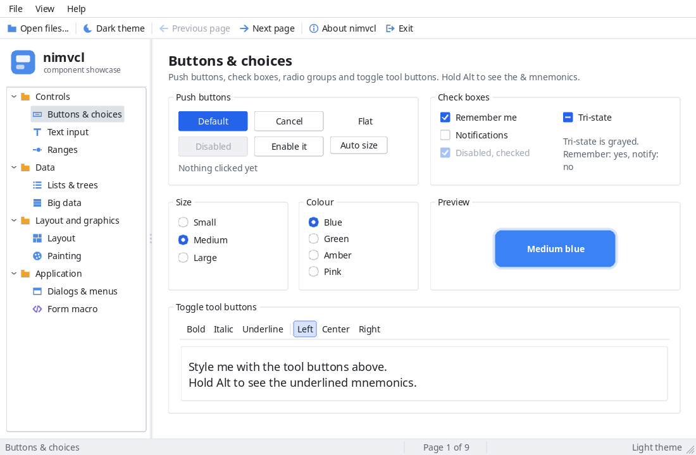
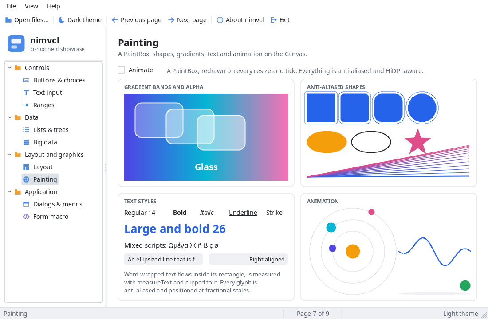

# nimvcl

A Delphi VCL-style UI library for Nim 2.2, drawn entirely with SDL3 (Linux
first, Windows and macOS experimental). Forms, `Align` and `Anchors`, `onClick`
events, actions, menus, and a `form` macro that works like a `.dfm` checked by
the compiler. Forms can also live in `.nfm` text files, which is what the
visual designer edits.

**Status:** version 0.2.0. The API can still change before 1.0; see the
[changelog](CHANGELOG.md). Source: <https://github.com/Vyrnexis/nimvcl>.

The companion IDE, a Delphi 7-style RAD environment with a visual form designer
built on nimvcl, is [NimRAD](https://github.com/Vyrnexis/NimRAD).



<p>



</p>

Run the gallery yourself: `nim c -r examples/showcase.nim`.

## Features

- Control tree with VCL-style properties and events: `align`, `anchors`,
  `margins`, `padding`, `constraints`, `autoSize`, `onClick` and friends.
  Anchors are relative to the design size, so they also work when a tiling
  window manager resizes the window first.
- Flat light and dark themes, HiDPI and fractional scaling, one SDL3 window per
  `Form`, modal forms, multiple windows.
- Delphi colour model: `color` is a control's background and `font.color` its
  text, both inherited from the parent (`parentColor`, `parentFont`); text
  colours can also follow the theme by role (`textRole`, `muted`).
- Fonts: Noto Sans and Noto Sans Mono are embedded in the executable, so an app
  needs no font files. Any `font.family` can also be a system font (fontconfig)
  or a project font registered from bytes, and CJK text finds a system fallback
  font automatically.
- Host mode: embed the UI in an existing SDL3 application.
- Controls: Label, Button, CheckBox, RadioButton, Panel, GroupBox, Edit, Memo,
  SpinEdit, ComboBox, ListBox, ListView, TreeView, DrawGrid and StringGrid,
  TrackBar, ProgressBar, ScrollBar, ScrollBox, Splitter, StatusBar, ToolBar,
  PageControl and TabControl, FlowPanel, GridPanel, PaintBox, Image, Bevel,
  Frame.
- `CodeEdit`: a source code editor with a gutter (line numbers, fold markers,
  breakpoint and bookmark icons), Nim syntax highlighting that follows the
  theme, code folding, bracket matching, a find and replace bar, auto-indent
  and a buffer that opens a 100 MB file in about a second.
- Docking: `DockSite` and `DockPanel` with split, tab and floating panels, drop
  guides, and layouts you can save and load.
- Main menu, popup menus, hints, `&` mnemonics, shortcuts.
- `ActionList` / `Action`: one command shared by menu items, tool buttons,
  buttons, check boxes and shortcuts.
- Dialogs: `showMessage`, `messageDlg`, `inputQuery`, native Open, Save and
  folder dialogs.
- `Timer`, `ImageList`, and a thread-safe `Application.queue` / `runOnUi`.
- Lists and trees (`ListBox`, `ListView`, `TreeView`) have type-ahead and share
  their keyboard navigation with the grids; a disabled control swallows mouse
  input like in the VCL.
- A `form` macro that declares a form with typed fields for its controls.
- Form files: `.nfm` text forms (a `.dfm` for nimvcl). `loadForm` turns one into
  a typed form at compile time without pulling in the property registry;
  `loadNfm` builds it at run time. Forms can inherit from other forms, as in
  Delphi.
- Design-time coverage: everything a form file stores can be edited in the
  Object Inspector, including `StringGrid.cells`, `colWidths` / `rowHeights`,
  `Edit.passwordChar`, `Button.images` / `imageIndex` / `imageAlignment`,
  `Form.icon` and `Form.menu`, and per-item images and check boxes of
  `ListView` and `TreeView` with an items editor dialog.
- Tooling for IDEs: a property registry (nimvcl's RTTI), an `ObjectInspector`
  with editors for colours, fonts, pictures, image lists, string lists and
  collections (and hooks for a context menu and for "differs from the
  ancestor" rows), and `FormDesigner` for selecting, moving, resizing, creating
  and undoing on a design surface.

## Example

```nim
import nimvcl

form MainForm:
  caption = "Demo"; width = 400; height = 300
  Button okBtn:
    caption = "&OK"; align = alBottom
    onClick = proc(sender: Control) = showMessage("Hello")

when isMainModule:
  Application.run(newMainForm())
```

The same without the macro:

```nim
import nimvcl

let form = newForm(nil, 400, 300)
form.caption = "Demo"
let ok = newButton(form, "&OK")
ok.align = alBottom
ok.onClick = proc(sender: Control) = showMessage("Hello")
Application.run(form)
```

`import nimvcl` brings in everything. Single modules can be imported instead
(`nimvcl/controls/listbox`, ...) for faster builds; `nimvcl/prelude` is the
small set that handler code needs (forms, dialogs, colours, timers, clipboard),
see [Imports and the prelude](docs/guide/imports.md).

## Install

Requirements: Nim 2.2+, SDL3, SDL3_ttf and SDL3_image, and the
[nim-lang/sdl3](https://github.com/nim-lang/sdl3) binding (installed by nimble).

- **Linux**: `pacman -S sdl3 sdl3_ttf sdl3_image` on Arch; other distros are in
  [Getting started](docs/getting-started.md).
- **Windows**: the official SDL3, SDL3_ttf and SDL3_image release zips from
  [libsdl-org](https://github.com/libsdl-org); put the DLLs next to the exe or
  on `PATH`. Not the MSYS2 build (see Platform support).
- **macOS**: `brew install sdl3 sdl3_ttf sdl3_image`; SDL is linked at build
  time (see Platform support).

Then `nimble install https://github.com/Vyrnexis/nimvcl`, or work from a clone
(`nim.cfg` already puts `src` on the path). The `requires` line for your own
`.nimble` file is in [Getting started](docs/getting-started.md).

## Platform support

- **Linux** (Wayland and X11): built and tested; this is what CI gates on.
- **Windows** and **macOS**: experimental. CI has jobs for both (allowed to
  fail) that build the examples and run the headless test suite; the results
  are listed in the workflow runs. Known so far:
  - SDL3 is loaded at run time on Windows (`SDL3.dll` must be next to the exe
    or on `PATH`) and linked at build time on macOS, see below.
  - System fonts are found by scanning the font folders (`%WINDIR%\Fonts`,
    `%LOCALAPPDATA%\Microsoft\Windows\Fonts`; `/System/Library/Fonts`,
    `/Library/Fonts`, `~/Library/Fonts`) and reading each file's name table;
    there is no fontconfig. TTC collections count with their first face. The
    bundled Noto fonts always work.
  - On macOS the Command key acts as Ctrl for shortcuts.
  - Form files (`.nfm`) may have CRLF line endings; the repository itself is
    checked out with LF (`.gitattributes`).
  - Headless runs: the tests use SDL's `offscreen` video driver; on macOS that
    driver cannot create windows, so use `SDL_VIDEO_DRIVER=dummy` there (what
    CI does; `scripts/test.sh` keeps a driver you already set).
  - Not verified: native file dialogs, clipboard, IME, HiDPI scaling and popup
    windows on those systems (all go through SDL3).
  - Install SDL3, SDL3_ttf and SDL3_image:
    - Windows: the official release zips from
      [libsdl-org](https://github.com/libsdl-org) (put the DLLs next to the
      exe or on `PATH`). Do not use the MSYS2 `mingw-w64-x86_64-sdl3` build: its
      `SDL_IOFromFile` fails for every path, so images, fonts and screenshots
      cannot be loaded or written.
    - macOS: `brew install sdl3 sdl3_ttf sdl3_image`. dyld does not find
      Homebrew's dylibs by bare name, so SDL is linked at build time instead:
      this repo's `nim.cfg` passes `--dynlibOverride:SDL3 --dynlibOverride:SDL3_ttf
      --dynlibOverride:SDL3_image --passL:"-L/opt/homebrew/lib -L/usr/local/lib
      -lSDL3 -lSDL3_ttf -lSDL3_image"`. Add the same to your own project's
      config when building without it.

## Documentation

Start at the [documentation index](docs/README.md).

- [Getting started](docs/getting-started.md): install, first window, tests.
- Guide: [application and forms](docs/guide/application-and-forms.md),
  [layout](docs/guide/layout.md),
  [events and input](docs/guide/events-and-input.md),
  [actions](docs/guide/actions.md),
  [threads and timers](docs/guide/threads-and-timers.md),
  [painting](docs/guide/painting.md), [theming](docs/guide/theming.md),
  [the form macro](docs/forms.md),
  [form files and the property registry](docs/guide/form-files.md),
  [docking](docs/guide/docking.md), [design mode](docs/guide/designer.md).
- Components: one page each, from [Label](docs/components/label.md) to
  [TreeView](docs/components/treeview.md); see the
  [component list](docs/README.md#components).
- Every module starts with a comment that documents its behaviour.

## Demos

```
nim c -r examples/settings_demo.nim   # a preferences app using (nearly) every control
nim c -r examples/std_demo.nim        # the standard controls
nim c -r examples/menu_demo.nim       # menus, popups, hints
nim c -r examples/controls_demo.nim   # basic controls
nim c -r examples/login_demo.nim      # the login form, keyboard only
nim c -r examples/list_demo.nim       # ListBox and ScrollBox
nim c -r examples/edit_demo.nim       # Edit
nim c -r examples/memo_demo.nim       # Memo
nim c -r examples/grid_demo.nim       # DrawGrid and StringGrid
nim c -r examples/views_demo.nim      # TreeView and ListView
nim c -r examples/editor_demo.nim     # a text editor: file tree, CodeEdit tabs, find bar
nim c -r examples/inspector_demo.nim  # the object inspector bound to a small form, .nfm save and reload
nim c -r examples/nfm_demo.nim        # a form loaded from a .nfm file at compile time
nim c -r examples/designer_demo.nim   # design mode on a form
nim c -r examples/dock_demo.nim       # docking: split, tab and float panels
nim c -r examples/showcase.nim        # the component gallery
```

(`nimble install -d` first; `nim.cfg` already puts `src` on the path.)

## Tests

```
nimble test
```

or one file: `SDL_VIDEO_DRIVER=offscreen SDL_RENDER_DRIVER=software nim c -r tests/tlistbox.nim`.
The tests run headless on SDL's offscreen video driver with the software
renderer, so no window opens. Popups use their top-level fallback there.

## License

MIT, see [LICENSE](LICENSE).
